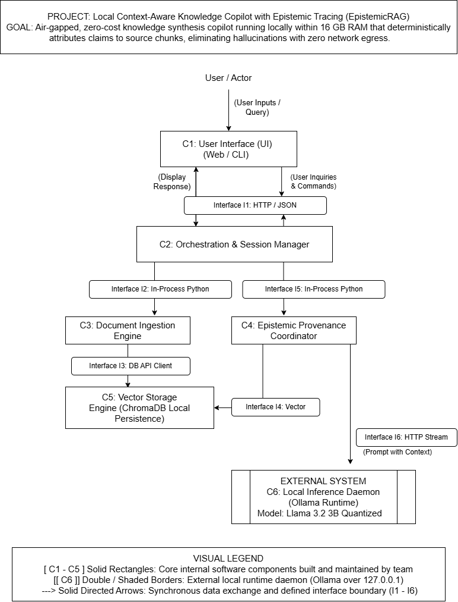
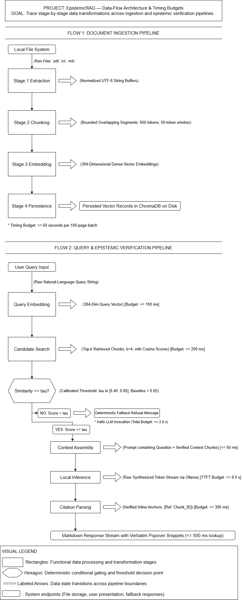

# CS 5001: Senior Design Deliverable (Design D0)
## High-Level Architecture & System Design
**Project Title:** Local Context-Aware Knowledge Copilot with Epistemic Tracing (EpistemicRAG)  
**Team Identifier:** EpistemicRAG  
**Repository:** https://github.com/areebmohammad1/senior-design-rag  
**Team Members:** Mohammad Areeb (Computer Science), Patrick Caudill (Geosciences)  
**Faculty Advisor:** Dr. Andre Curtis-Trudel (Department of Philosophy / Center for Humanities and Technology)

---

## 1. Title, Goal Statement, Conventions, & System Inputs/Outputs

### System Goal Statement
An air-gapped, zero-cost knowledge synthesis copilot running locally within 16 GB system RAM on standard CPU hardware that deterministically attributes generated claims to source document chunks, eliminating hallucinations with zero network egress.

### Basic System Inputs and Outputs
* **Basic Input:** Local text/document files (`.pdf`, `.txt`, `.md`) for corpus ingestion, and natural language query strings submitted by the user.
* **Basic Output:** Streamed natural-language synthesis text enriched with inline citation anchors (e.g., `[Ref: Chunk_ID]`) linking directly to source text snippets and metadata, or an explicit calibrated fallback refusal.

### Diagram Conventions & Legend
* **Solid Rectangles [C1 – C5]:** Core internal software components built and maintained by the team.
* **Double / Shaded Borders [[C6]]:** External local runtime daemon (Ollama over `localhost:11434` / 127.0.0.1).
* **Solid Directed Arrows:** Synchronous data exchange and defined interface boundaries (I1 – I6).

---

## 2. Block Diagram (D0 High-Level View)



---

## 3. Component Responsibility Table

| Component ID & Name | Single Responsibility Statement | Interfaces In / Out | Primary Owner |
| :--- | :--- | :--- | :--- |
| **C1: User Interface (UI)** | Renders the web/CLI interface for document selection, query submission, citation anchor inspection, and response rendering. | **In:** User Input<br>**Out:** I1 | Mohammad Areeb |
| **C2: Orchestration & Session Manager** | Coordinates execution flow between UI, ingestion, vector store, and provenance coordinator while maintaining session state. | **In:** I1<br>**Out:** I2, I5 | Mohammad Areeb |
| **C3: Document Ingestion Engine** | Parses raw document files (`.pdf`, `.md`, `.txt`), chunks text, extracts metadata, and generates embeddings for vector indexing. | **In:** I2<br>**Out:** I3 | Patrick Caudill |
| **C4: Epistemic Provenance Coordinator** | Evaluates similarity score confidence thresholds against calibrated limits ($\tau$), constructs grounded prompts, and attaches citation metadata. | **In:** I5, I4<br>**Out:** I4, I6 | Patrick Caudill |
| **C5: Vector Storage Engine** | Manages local persistence, indexing, and nearest-neighbor cosine similarity queries over document embeddings using ChromaDB. | **In:** I3, I4<br>**Out:** I4 | Patrick Caudill |
| **C6: Local Inference Daemon** | Executes quantized local LLM inference (Llama 3.2 3B) via Ollama over `127.0.0.1` without outbound network access. | **In:** I6<br>**Out:** I6 Stream | Mohammad Areeb |

---

## 4. Interface Specification Table

| Interface ID | Connected Components | Input Data & Types | Output Data & Types | Protocol / Format | Failure / Error Handling |
| :--- | :--- | :--- | :--- | :--- | :--- |
| **I1** | C1 $\leftrightarrow$ C2 | `query` (string), `session_id` (string) | `response_stream` (text/event-stream), `citations` (JSON list) | HTTP / REST & JSON over localhost | Catches validation/network errors; returns HTTP 400/500 JSON payload to C1. |
| **I2** | C2 $\rightarrow$ C3 | `file_path` (string), `chunk_size` (int) | `ingest_status` (bool), `chunk_count` (int) | In-Process Python Function Call | Logs parsing failures to `logs/copilot_error.log`; raises `IngestionError`. |
| **I3** | C3 $\rightarrow$ C5 | `chunks` (list[dict]), `embeddings` (list[float]) | `upsert_count` (int), `status` (string) | DB API Client (ChromaDB Native Python SDK) | Handles disk full/write lock errors; retries write or raises `StorageError`. |
| **I4** | C4 $\leftrightarrow$ C5 | `query_vector` (list[float]), `top_k` (int) | `matched_chunks` (list[dict]), `scores` (list[float]) | In-Process Python API / ChromaDB Query | Handles empty vector store; returns empty result list to C4 to trigger fallback. |
| **I5** | C2 $\rightarrow$ C4 | `user_query` (string), `confidence_threshold` (float) | `grounded_response` (string), `provenance_map` (dict) | In-Process Python Function Call | Catches sub-threshold scores; generates calibrated refusal string. |
| **I6** | C4 $\rightarrow$ C6 | `formatted_prompt` (string), `temperature` (float) | `token_stream` (text/event-stream) | HTTP REST Stream (`http://localhost:11434/api/generate`) | Catches socket timeout (>30.0s); emits `ERR_LOCAL_ENGINE_UNAVAILABLE` to C2/C1. |

### Example Interface Payload (Interface I1 Request/Response)
```json
// I1 Request Payload (C1 -> C2)
{
  "session_id": "sess-98234-a",
  "query": "What are the core reportable outcomes for award HRD-2026?",
  "top_k": 4
}

// I1 Response Payload (C2 -> C1)
{
  "status": "success",
  "response_text": "The project achieved milestone M2 under award HRD-2026 [Ref: Chunk_882].",
  "citations": [
    {
      "chunk_id": "Chunk_882",
      "file_name": "Grant_Report_2026.pdf",
      "page_number": 14,
      "similarity_score": 0.78,
      "verbatim_snippet": "Milestone M2 was successfully completed on schedule with zero cost overruns."
    }
  ]
}
```
---

## 5. Data-Flow Diagram



### Data-Flow Descriptions & Timing Budgets
1. **Corpus Ingestion Flow:** Raw `.pdf`/`.md` files -> Text Chunks & Metadata -> Embeddings (d=384) -> ChromaDB Storage. *(Offline / Pre-query)*.
2. **Query & Retrieval Flow:** Raw Query -> Query Embedding -> Top-k Similar Chunks (k=4) -> Score Threshold Check (tau = 0.65 baseline). *(Timing budget: <= 500 ms)*.
3. **Synthesis & Citation Flow:** Valid Chunks + Prompt -> Local Ollama LLM Stream -> Anchored Response + Provenance Metadata. *(Timing budget: Time-to-first-token <= 3.0 s, complete generation <= 15.0 s)*.

---

## 6. Architecture Pattern & Justification

### Selected Pattern: Combination Pipeline & Client-Server Architecture
* **Client-Server Pattern:** Governs the relationship between C1 (Web/CLI UI) and C2 (Orchestrator) over Interface I1, as well as C4 and C6 (Ollama Daemon) over Interface I6.
* **Pipeline (Pipe-and-Filter) Pattern:** Governs the sequential retrieval and prompt assembly pipeline (Retrieval -> Scoring/Threshold Filtering -> Context Injection -> Citation Mapping).

### Justification Against Class Criteria
1. **Fit to the Problem:** RAG and epistemic tracing inherently follow a staged data transformation pipeline.
2. **Team Skills:** Both team members are proficient in Python, REST APIs, and modular component separation.
3. **Performance & Timing:** Local client-server streaming over loopback (127.0.0.1) minimizes communication overhead while enforcing a strict 30-second timeout.
4. **Scalability:** ChromaDB and Ollama run in separate processes, allowing independent scaling or swapping of local model runtimes without modifying UI or Orchestration code.
5. **Hardware Constraints:** Fitting within 16 GB system RAM requires in-process Python component management rather than heavy multi-container microservice overhead.

### Rejected Architectural Pattern
* **Microservices Architecture:** Rejected due to excessive memory footprint, container orchestration overhead (Docker/Kubernetes), and IPC latency on a single 16 GB CPU workstation.

---

## 7. Decision Log

1. **Decision 1: Local Ollama Daemon over Embedded Python LLM Bindings**
   * *Alternatives Considered:* llama-cpp-python direct binding vs. external process Ollama service.
   * *Rationale:* Ollama runs as an isolated background daemon with VRAM/RAM management, preventing Python process crashes if LLM memory spikes.

2. **Decision 2: Local Persistence Vector Database (ChromaDB) over Remote Cloud Stores**
   * *Alternatives Considered:* Pinecone / Qdrant Cloud vs. Local ChromaDB.
   * *Rationale:* Enforces strict zero-network data egress compliance for confidential manuscripts and grant proposals.

3. **Decision 3: Hard Fallback Refusal Threshold (tau = 0.65) over Unrestricted Synthesis**
   * *Alternatives Considered:* Always passing top-k chunks to LLM vs. checking cosine similarity threshold score.
   * *Rationale:* Prevents ungrounded extrapolation and hallucinations when relevant context is absent from the indexed corpus.

4. **Decision 4: In-Process Function Calls for Pipeline Components (C2, C3, C4, C5)**
   * *Alternatives Considered:* gRPC or internal REST endpoints between all internal sub-modules.
   * *Rationale:* Keeps resident memory footprint below 12 GB RAM and eliminates inter-process serialization latency.
