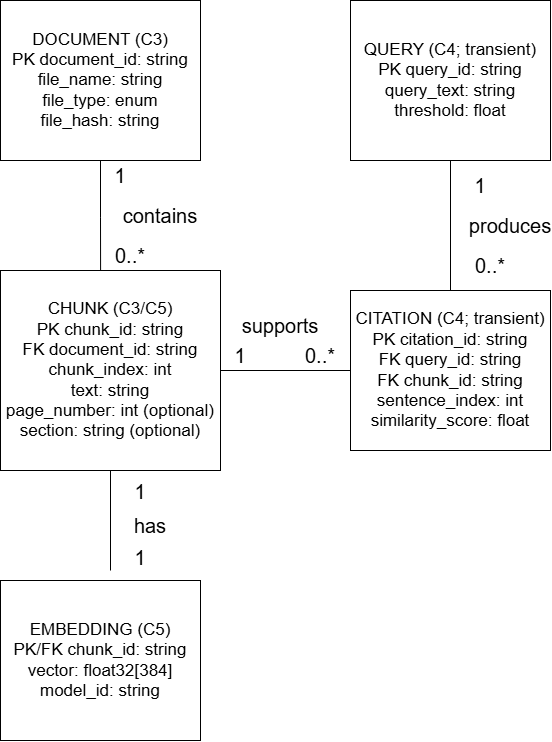

# CS 5001: Senior Design Deliverable (Design D1)

## Detailed Design: EpistemicRAG

**Project Title:** Local Context-Aware Knowledge Copilot with Epistemic Tracing (EpistemicRAG)  
**Team:** Mohammad Areeb (Computer Science), Patrick Caudill (Geosciences)  
**Faculty Advisor:** Dr. Andre Curtis-Trudel  
**Repository:** https://github.com/areebmohammad1/senior-design-rag

---

## 1. Header, Scope, and Conventions

### System Goal Statement

An air-gapped, zero-cost knowledge synthesis copilot running locally within 16 GB system RAM on standard CPU hardware that deterministically attributes generated claims to source document chunks, eliminating hallucinations with zero network egress.

### Scope

D1 details **C3 (Document Ingestion Engine)**, **C5 (Vector Storage Engine)**, and **C4 (Epistemic Provenance Coordinator)** from D0. C1 (UI), C2 (Orchestration), and C6 (Ollama Daemon) are deferred to D2.

### Diagram Conventions

Rectangles represent logical entities with key attributes. `PK` and `FK` identify primary and foreign keys. Solid lines indicate relationships, with `1`, `0..1`, `0..*`, or `1..*` marking cardinality at each endpoint. Dashed lines, if present, indicate dependencies rather than persisted relationships. Component and interface IDs retain D0's C1–C6 and I1–I6 conventions.

---

## 2. Data Model, the D1 Diagram

### Logical Data Model

EpistemicRAG uses **locally persisted ChromaDB**, rather than a relational database, to store document chunks, metadata, and 384-dimensional embeddings. Query and citation records are transient Python objects.



**Figure 1:** Logical entities and their relationships for C3, C5, and C4.

### Core Entities

| Entity | Key Attributes | Component |
| :--- | :--- | :--- |
| Document | `document_id` (PK), `file_name`, `file_type`, `file_hash` | C3 |
| Chunk | `chunk_id` (PK), `document_id` (FK), `chunk_index`, `text`, `page_number`, `section` | C3, C5 |
| Embedding | `chunk_id` (PK/FK), `vector` (float32[384]), `model_id` | C5 |
| Query | `query_id` (PK), `query_text`, `threshold` | C4 |
| Citation | `citation_id` (PK), `query_id` (FK), `chunk_id` (FK), `sentence_index`, `similarity_score` | C4 |

**Relationships:** Document (1) → Chunk (0..*); Chunk (1) → Embedding (1, once indexed); Query (1) → Citation (0..*); Chunk (1) → Citation (0..*). Each chunk belongs to one document, and each citation references one query and one source chunk. These relationships support US-01 and US-03.

### Structural Decisions and Indexing

| Decision | Justification | Requirement |
| :--- | :--- | :--- |
| Separate Document and Chunk entities (1:N) | Documents contain multiple independently retrievable and citable passages; each chunk has one source. | US-01, I2–I4 |
| Separate Embedding entity (1:1) | Each indexed chunk has one active 384-dimensional vector for similarity retrieval. | I3, I4 |
| Citation as a separate entity | Multiple sentences and queries may reference the same chunk; a citation links a particular sentence to its source. | US-01, AC-01.1 |
| Index vectors by cosine similarity | Enables top-k semantic retrieval (`k=4`) without application-level exhaustive comparisons. | UC-01, I4 |
| Index/identify by `chunk_id`; filter by `document_id` | Supports source lookup within 500 ms and document-level filtering. | AC-01.1 |
| Use `file_hash` for duplicate detection | Prevents redundant ingestion of identical document content. | I2, I3 |

**Integrity constraints:** Chunks use deterministic IDs and preserve page/section metadata. Each embedding contains 384 finite values; document and query embeddings use the same model. ChromaDB cosine distance is converted to similarity (`1 - distance`) before threshold comparison (baseline τ = 0.65). Every emitted citation must resolve to an indexed chunk.

**Storage rationale:** ChromaDB supports local vector indexing and metadata retrieval without the additional synchronization, memory, and maintenance costs of a separate SQL database, supporting US-02 (privacy) and US-04 (resource limits).

---

## 3. Core Algorithms

### Algorithm 1: Document Ingestion and Vector Retrieval (C3/C5)

**Purpose:** Convert local documents into searchable embeddings and retrieve the most relevant chunks for a query (US-01, I2–I4).

**Inputs:** `file_path: str` (`.pdf`, `.md`, `.txt`), `chunk_size: int = 500`, `overlap: int = 50`; retrieval inputs: `query: str`, `top_k: int = 4`.

**Outputs:** `chunk_count: int`, indexed `float32[384]` embeddings, and `matched_chunks: list[dict]` containing chunk IDs, text, metadata, and cosine similarity scores.

**Procedure:**
1. Extract text and source metadata; split into 500-token chunks with 50-token overlap.
2. Generate 384-dimensional embeddings using the local sentence-transformers model and upsert them into ChromaDB.
3. Embed the user query with the same model and retrieve the four nearest chunks using cosine similarity.

**Complexity:** Let `T` be input tokens, `N` indexed chunks, and `d = 384`. Chunking is O(T); embedding computation scales with model inference cost per chunk. An exhaustive similarity search costs O(Nd), while ChromaDB's approximate index typically reduces retrieval work, without a guaranteed logarithmic bound. At an assumed 10,000 chunks, exhaustive comparison involves approximately 3.84 million vector dimensions; at 100× scale (1,000,000 chunks), approximately 384 million. The larger corpus may require index and memory profiling to maintain latency targets.

**Why this approach:** Local embeddings and ChromaDB provide semantic matching without cloud transmission. Keyword-only search misses paraphrases, while a custom vector index would increase implementation effort.

**Edge cases:** Empty/unsupported files produce `IngestionError`; exact duplicate files are detected using SHA-256; invalid or non-finite embeddings are rejected; an empty vector store returns no matches; tied scores are ordered by `chunk_id` for deterministic output.

### Algorithm 2: Epistemic Thresholding and Citation Verification (C4)

**Purpose:** Prevent unsupported generation by rejecting low-confidence retrieval results and validating sentence-level citation references (US-01, US-03, AC-01.1–AC-01.2).

**Inputs:** `query: str`, `matched_chunks: list[dict]`, `tau: float = 0.65` (allowed range `[0.40, 0.85]`), `generated_text: str` when generation occurs.

**Outputs:** `status: str` (`success` or `low_confidence`), `response_text: str`, `citations: list[dict]`, and `top_score: float | None`.

**Procedure:**
1. Calculate the maximum retrieved cosine similarity score.
2. If no chunks exist or `top_score < tau`, return a calibrated refusal without calling Ollama (≤ 2.0 s target).
3. Otherwise, construct a grounded prompt containing eligible chunks and their IDs.
4. Check each factual sentence for a valid `[Ref: Chunk_ID]` anchor referencing an eligible chunk. Suppress unsupported sentences or return a refusal if verification fails.
5. Return the cited response and source metadata for citation inspection (≤ 500 ms lookup target).

**Complexity:** Threshold evaluation costs O(k), where `k = 4`. Citation validation costs O(S + A) using a hash set of eligible chunk IDs, where `S` is the generated text length and `A` is the number of citation anchors. This remains effectively independent of total corpus size after retrieval.

**Why this approach:** A deterministic threshold and citation checks are inexpensive and auditable compared with unrestricted generation or an additional LLM-based verification pass. The threshold is selected through an F1-maximizing sweep from 0.40 to 0.85 in increments of 0.05 using 20 grounded and 20 out-of-domain queries.

**Edge cases:** Empty results trigger refusal; exact-threshold scores pass (`score >= tau`); tied scores use deterministic chunk-ID ordering; invalid scores or unknown citation IDs fail verification; Ollama timeout triggers `ERR_LOCAL_ENGINE_UNAVAILABLE` after 30 seconds (AC-01.3).

**Limitation:** A valid citation anchor establishes traceability, not semantic proof that a claim is supported. The system targets zero uncited factual assertions but cannot guarantee elimination of all hallucinations.

---

## 4. Build-versus-Reuse Decisions

The team will build EpistemicRAG-specific ingestion orchestration, thresholding, and provenance validation while reusing established local libraries for parsing, embeddings, and vector storage.

| Component / Function | Decision | Library / License | Maturity, Performance, and Fit |
| :--- | :--- | :--- | :--- |
| C3: Document parsing | Reuse | PyMuPDF / AGPL-3.0 or commercial | Mature, efficient PDF text extraction; license obligations require review before distribution. |
| C3: Text chunking and metadata | Build | Python / PSF License | Lightweight custom logic preserves page references and deterministic chunk IDs. |
| C3: Embedding generation | Reuse | sentence-transformers / Apache-2.0 | Established library supporting local CPU inference and 384-dimensional embeddings with a compatible model. |
| C5: Vector indexing and persistence | Reuse | ChromaDB / Apache-2.0 | Established local vector store with cosine similarity search and metadata filtering. |
| C4: Threshold calibration | Build | Python / PSF License | Small, testable algorithm tailored to the 40-query evaluation protocol. |
| C4: Citation mapping and validation | Build | Python / PSF License | Project-specific logic required to enforce chunk-ID provenance and reject invalid anchors. |
| C4/C6: Local LLM inference | Reuse | Ollama / MIT; Llama 3.2 / Meta Llama 3.2 Community License | Local CPU inference through loopback; model weights have separate licensing terms. |

**Licensing and deployment:** All dependencies must be installed and model weights downloaded before entering air-gapped operation. PyMuPDF's AGPL obligations must be reviewed; if unsuitable, the team can evaluate a permissively licensed PDF parser. Runtime execution must generate zero outbound network requests (US-02).

---


## 5. API Contract

Components C3, C5, and C4 communicate through in-process Python methods, preserving D0 interfaces I2–I5. C4 communicates with the local Ollama daemon through I6. All data remains on the local workstation.

### 5.1 Methods and Parameters

| Interface / Method | Inputs (Type, Requirement, Range) | Outputs | Errors |
| :--- | :--- | :--- | :--- |
| I2: `ingest_document()` (C3) | `file_path: str` (required; existing `.pdf`, `.md`, `.txt`); `chunk_size: int` (optional, default 500, > 50) | `{"ingest_status": bool, "chunk_count": int}` | `INVALID_FILE` (missing/unsupported); `IngestionError` (parsing failure) |
| I3: `upsert_chunks()` (C5) | `chunks: list[dict]` (required); `embeddings: list[list[float]]` (required; each vector length 384, finite values) | `{"upsert_count": int, "status": str}` | `INVALID_EMBEDDING` (dimension/values); `StorageError` (write failure) |
| I4: `retrieve_chunks()` (C5) | `query_vector: list[float]` (required, length 384); `top_k: int` (optional, default 4, 1–20) | `{"matched_chunks": list[dict], "scores": list[float]}` | `INVALID_QUERY_VECTOR`; `StorageError`; empty store returns empty lists |
| I5: `generate_grounded_response()` (C4) | `user_query: str` (required, nonempty); `confidence_threshold: float` (optional, default 0.65, range 0.40–0.85) | `{"status": str, "grounded_response": str, "provenance_map": dict, "top_score": float \| null}` | `INVALID_QUERY`; `INVALID_THRESHOLD`; `ERR_LOCAL_ENGINE_UNAVAILABLE` |
| I6: Ollama `/api/generate` (C6) | `formatted_prompt: str` (required); `temperature: float` (optional, 0–1, default 0) | Local token stream containing generated text | `ERR_LOCAL_ENGINE_UNAVAILABLE` (connection failure/30 s timeout) |

**Response schemas:**

- `matched_chunks`: list of objects containing `chunk_id: str`, `text: str`, `document_id: str`, `file_name: str`, `page_number: int | null`, `similarity_score: float` (cosine similarity, unitless).
- `scores`: list of cosine similarity floats aligned with `matched_chunks`, ordered from highest to lowest.
- `provenance_map`: dictionary keyed by citation anchor, with values containing `chunk_id: str`, `file_name: str`, `page_number: int | null`, `similarity_score: float`, and `verbatim_snippet: str`.
- `top_score`: highest retrieved similarity (unitless), or `null` when no matches exist.
- `status`: `success` or `low_confidence`; operational failures raise the listed error codes.

### 5.2 Example Request and Response (I5)

**Request:**

```json
{
  "user_query": "What were the outcomes of award HRD-2026?",
  "confidence_threshold": 0.65
}
```

**Successful response (illustrative):**

```json
{
  "status": "success",
  "grounded_response": "Milestone M2 was completed [Ref: Chunk_882].",
  "top_score": 0.78,
  "provenance_map": {
    "Chunk_882": {
      "chunk_id": "Chunk_882",
      "file_name": "Grant_Report_2026.pdf",
      "page_number": 14,
      "similarity_score": 0.78,
      "verbatim_snippet": "Milestone M2 was successfully completed on schedule."
    }
  }
}
```

**Low-confidence response:** If all scores fall below the threshold, return `status = "low_confidence"`, an explicit refusal in `grounded_response`, an empty `provenance_map`, and the highest score (or `null` if the corpus is empty). Ollama is not invoked (AC-01.2).

**Versioning:** Internal method contracts use semantic versioning beginning at `1.0.0`, tracked in the repository. Renaming required parameters, changing field types, removing response fields, or changing error semantics constitutes a breaking change requiring a major version increment.

---

## 6. Technology Choices with Justification

### Database: ChromaDB

**Team skill fit:** ChromaDB's Python API aligns with the team's Python development experience. **Licensing:** Apache-2.0 permits local use and modification. **Community:** Its established open-source ecosystem provides documentation and examples. **Performance:** Local vector indexing and metadata filtering support cosine similarity retrieval without a separate database server, subject to profiling at 10,000 and 1,000,000 chunks. **Cost/hosting:** Free, locally persisted, and compatible with air-gapped execution. Pinecone was rejected because its cloud hosting conflicts with US-02.

### Backend and Embeddings: Python and sentence-transformers

**Team skill fit:** Both team members have Python experience, allowing direct implementation of C3–C5. **Licensing:** Python uses the PSF License and sentence-transformers uses Apache-2.0; selected model weights require separate license verification. **Community:** Both have extensive documentation and established developer ecosystems. **Performance:** In-process Python methods minimize communication overhead, while 384-dimensional embeddings support CPU-based semantic retrieval. **Cost/hosting:** Both run locally without subscription fees. A distributed microservices backend was rejected due to unnecessary memory and deployment overhead (US-04).

### Front End: Lightweight Local Web/CLI Interface

**Team skill fit:** A Python-based interface reduces integration complexity with the backend. **Licensing:** The final UI framework must use a license compatible with free local deployment. **Community:** A widely maintained Python framework will provide documentation and support. **Performance:** A lightweight interface avoids unnecessary memory usage and supports citation inspection within 500 ms. **Cost/hosting:** The UI will run entirely on localhost without paid hosting. A cloud-hosted frontend was rejected because of the zero-network requirement (US-02). The specific framework will be finalized in D2.

### Local Inference and Messaging: Ollama / Llama 3.2 3B

**Team skill fit:** Ollama's HTTP API integrates with Python and the existing D0 interfaces. **Licensing:** Ollama is MIT-licensed; Llama 3.2 uses Meta's separate community license. **Community:** Both have established documentation and developer support. **Performance:** Quantized 3B inference is feasible on CPU hardware, with a 30-second daemon timeout and 12 GB active RAM ceiling requiring benchmark validation. **Cost/hosting:** Inference runs locally over `127.0.0.1:11434` with no cloud charges. Direct `llama-cpp-python` integration was considered but rejected in D0 in favor of Ollama's isolated daemon and model management.

### Hosting and Hardware: Single Local CPU Workstation

**Team skill fit:** A single-machine deployment simplifies setup, debugging, and maintenance for a two-person team. **Licensing:** Local execution avoids proprietary cloud-platform dependencies; operating-system and library licenses remain applicable. **Community:** Python, ChromaDB, and Ollama support common desktop operating systems. **Performance:** The design targets 16 GB system RAM, ≤ 12 GB active application memory, and no GPU requirement. **Cost/hosting:** Existing hardware eliminates capital and hosting expenses. Docker/Kubernetes orchestration was rejected because of additional resource overhead and deployment complexity.

---
