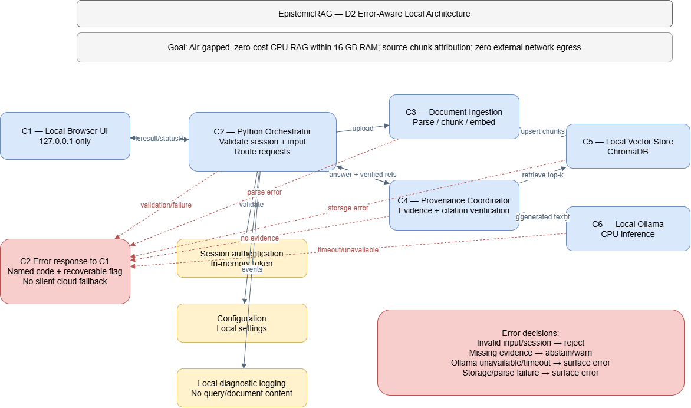

# D2 — Detailed Design

**Project:** Local Context-Aware Knowledge Copilot with Epistemic Tracing (EpistemicRAG)  
**Team:** Mohammad Areeb (Computer Science); Patrick Caudill (Geosciences)  
**Advisor:** Dr. Andre Curtis-Trudel  
**Status:** Design specification; implementation and validation pending.

## 1. Header, Conventions, and D2 Overview

**D0 goal (verbatim):** “An air-gapped, zero-cost knowledge synthesis copilot running locally within 16 GB system RAM on standard CPU hardware that deterministically attributes generated claims to source document chunks, eliminating hallucinations with zero network egress.” *Eliminating hallucinations is a project objective, not a demonstrated guarantee.*

**Two-minute overview.** EpistemicRAG lets a researcher upload local documents, ask questions through a browser on `127.0.0.1`, retrieve relevant chunks from a local vector store, and generate answers using a local Ollama model with traceable citations. D0 established the six-component architecture. D1 detailed C3 ingestion, C4 epistemic provenance, and C5 vector storage, including their data entities, algorithms, and interfaces. D2 completes C1 browser UI, C2 orchestration, C6 inference, and supporting session, configuration, and logging functions; it adds failure paths, traceability, rationale, and peer-review actions.

**Diagram conventions.** In the accompanying `EpistemicRAG_D2_Architecture.drawio`, labeled rectangles are components or handlers; solid arrows are normal request/data flows; dashed red arrows are failure paths. Labels identify the interface or error. D1's entity-relationship diagram uses entities as boxes, PK/FK labels for keys, and labeled relationships for cardinality. The D0 block and data-flow diagrams retain their original conventions. **Each diagram should display the project title and goal statement in its caption or heading when exported into the consolidated PDF.**

**Known gaps:** Implementation has not begun; model latency and peak RAM have not been benchmarked; exact library versions and license compatibility remain to be verified; secure browser-session bootstrap and performance acceptance criteria require team confirmation. These are tracked as design risks rather than presented as completed tests.

## 2. Finished Components — D2 Diagrams

D1 remains authoritative for C3, C4, C5 and the persistent entities **Document, Chunk, Embedding, Query, Citation**. The following completes the other D0 components and glue functions. Internal functions below are *proposed signatures*, not implemented code.

| Component | Data model | Behavior | Interface / errors |
|---|---|---|---|
| **C1 — Local browser UI** | No persistent data; transient input, response, citation, and request-status state | Accept document/query; validate basic input; call C2; show answer, sources, and errors | `POST /api/documents`, `POST /api/query`, `GET /api/status`; `INVALID_FILE`, `INVALID_QUERY`, `SERVICE_UNAVAILABLE` |
| **C2 — Python orchestrator** | No new persistent entities; uses D1 entities; in-memory request state | Authenticate, validate, route uploads to C3, queries to C4/C5, evidence to C6, and results to C1 | `handle_upload(file)`, `handle_query(query, options)`; `UNAUTHORIZED`, `INGESTION_FAILED`, `RETRIEVAL_FAILED`, `GENERATION_FAILED` |
| **C6 — Local Ollama inference** | No project-specific persistent data; local model artifacts managed by Ollama | Check local model availability; generate from question + retrieved evidence; return text or explicit failure | `generate_response(question, context_chunks, model_name)`; `MODEL_UNAVAILABLE`, `INFERENCE_TIMEOUT`, `RESOURCE_EXHAUSTED` |
| **Session authentication** | Ephemeral local session token; no user-account database | Initialize session and validate protected requests; bind service to loopback | `initialize_session()`, `validate_session(token)`; `INVALID_SESSION`, `UNAUTHORIZED` |
| **Configuration** | Local configuration file/values (model, `k`, threshold, storage path, bind address) | Load at startup; validate allowed ranges; refuse unsafe network bind | `load_config()`, `validate_config()`; `INVALID_CONFIG`, `UNSAFE_BIND` |
| **Logging** | Local diagnostic events only; no full documents, prompts, or secrets | Record operation ID, timestamp, status and error code; report logging failure without disclosing private data | `log_event(operation, status, error_code)`; `LOG_WRITE_FAILED` |
| **Notifications** | No persistent data | In-app progress, success, warning, and error messages through C1; no email/push service | `display_status(request_id, status, message)`; `UI_UNAVAILABLE` |

**Example browser-facing query contract (proposed):**

```json
{"query":"What does the document conclude?","top_k":4,"similarity_threshold":0.65}
```

**Response shape (illustrative, not an actual result):**

```json
{"status":"success","answer":"...","citations":[{"chunk_id":"chunk_001","document_id":"doc_001"}]}
```

**D0 interface review:** C1 communicates only with C2, never directly with ChromaDB or Ollama. Use one structured query object rather than many positional parameters. C2 passes retrieved chunk IDs and source text to C6; citation verification remains under C4, not the language model. No network-facing service or cloud fallback is allowed. Configuration changes are initially backend-managed rather than exposed as unrestricted browser controls.

**Figure D2-1 — Architecture and Error Handling**



Solid arrows represent normal data flow;
dashed red arrows represent error paths.

## 3. Edge Cases and Error Handling

**Categories:** BV = boundary values; TC = timing/concurrency; BI = bad/missing input; ED = external dependency. Each row identifies a decision, handler, and recoverability. "External" includes local dependencies such as Ollama and disk access, not internet services.

| ID | Component | Category | Edge case | Decision / named handler | Recoverable? |
|---|---|---|---|---|---|
| E01 | C1 | BV | Empty or excessively long query | Reject with `INVALID_QUERY`; `C1.validate_input` | Yes, edit input |
| E02 | C1 | TC | User double-submits request | Disable submit while pending; `C1.request_guard` | Yes |
| E03 | C1 | BI | Unsupported document extension | Surface `INVALID_FILE`; `C1.validate_upload` | Yes |
| E04 | C1 | ED | Local backend unreachable | Surface service-unavailable status; `C1.api_error_handler` | Yes, restart backend |
| E05 | C2 | BV | `top_k` or threshold outside allowed range | Reject `INVALID_CONFIG`; `C2.validate_options` | Yes |
| E06 | C2 | TC | Concurrent upload and query | Serialize affected index operations or return busy/retry; `C2.request_coordinator` | Yes |
| E07 | C2 | BI | Missing session token | Reject `UNAUTHORIZED`; `C2.auth_guard` | Yes |
| E08 | C2 | ED | Storage/inference dependency fails | Return structured error, never cloud fallback; `C2.dependency_handler` | Sometimes |
| E09 | C3 | BV | Empty document / zero extracted text | Reject ingestion; `C3.ingestion_validator` | Yes, replace file |
| E10 | C3 | TC | Duplicate or interrupted ingestion | Use document ID/status to prevent inconsistent partial inserts; `C3.ingestion_transaction` | Yes, retry |
| E11 | C3 | BI | Corrupt or unsupported PDF | Reject with parse error; `C3.parser_error_handler` | Yes, replace file |
| E12 | C3 | ED | Parser or embedding model unavailable | Stop ingestion and surface dependency error; `C3.ingestion_dependency_handler` | Yes after repair |
| E13 | C4 | BV | Similarity below threshold / no evidence | Abstain or return insufficient-evidence notice; `C4.evidence_gate` | Yes, new query/data |
| E14 | C4 | TC | Citation refers to modified/deleted chunk | Revalidate IDs before answer; `C4.citation_validator` | Sometimes |
| E15 | C4 | BI | Missing citation or unsupported generated claim | Withhold unsupported citation/claim and warn; `C4.claim_checker` | Sometimes |
| E16 | C4 | ED | Retrieval unavailable | Surface `RETRIEVAL_FAILED`; `C4.retrieval_handler` | Yes after repair |
| E17 | C5 | BV | Empty index / fewer than `k` matches | Return available matches or empty result; `C5.query_handler` | Yes |
| E18 | C5 | TC | Simultaneous write and retrieval | Use consistent index snapshot/locking policy; `C5.index_coordinator` | Yes |
| E19 | C5 | BI | Wrong embedding dimension (expected 384) | Reject incompatible vector; `C5.dimension_validator` | Yes |
| E20 | C5 | ED | Disk full / ChromaDB inaccessible | Fail safely; preserve existing records where possible; `C5.storage_handler` | Sometimes |
| E21 | C6 | BV | Prompt/context exceeds local model window | Truncate context by ranked chunks or reject; `C6.context_budgeter` | Yes |
| E22 | C6 | TC | Model inference exceeds timeout | Cancel/timeout and surface error; `C6.timeout_handler` | Yes, retry |
| E23 | C6 | BI | Empty question or context payload | Reject `INVALID_CONTEXT`; `C6.input_validator` | Yes |
| E24 | C6 | ED | Ollama stopped, model missing, or memory exhausted | Surface explicit failure, no cloud fallback; `C6.model_handler` | Sometimes |
| E25 | Auth | BV | Expired/invalid token | Deny and reinitialize session; `Auth.session_validator` | Yes |
| E26 | Auth | TC | Restart invalidates active sessions | Require new local session; `Auth.session_bootstrap` | Yes |
| E27 | Auth | BI | Missing/altered token | Reject `UNAUTHORIZED`; `Auth.session_validator` | Yes |
| E28 | Auth | ED | Secure token generation fails | Abort protected service startup; `Auth.bootstrap_handler` | No until repaired |
| E29 | Config | BV | Threshold outside 0–1 / `k` < 1 | Reject invalid settings; `Config.range_validator` | Yes |
| E30 | Config | TC | Configuration changed mid-request | Apply on next request/restart, not mid-flight; `Config.snapshot_loader` | Yes |
| E31 | Config | BI | Missing or malformed config | Load documented safe defaults or refuse startup; `Config.loader` | Yes |
| E32 | Config | ED | Unsafe non-loopback bind requested | Reject startup; `Config.bind_guard` | Yes |
| E33 | Logging | BV | Log exceeds local size cap | Rotate/limit local logs; `Logging.rotator` | Yes |
| E34 | Logging | TC | Concurrent log writes | Queue/serialize writes; `Logging.writer` | Yes |
| E35 | Logging | BI | Sensitive text in log fields | Redact/drop sensitive fields; `Logging.redactor` | Yes |
| E36 | Logging | ED | Log path unwritable | Warn without blocking core work unless security audit requires it; `Logging.error_handler` | Yes |
| E37 | Notifications | BV | Very long status/error text | Truncate display, preserve error code; `Notify.formatter` | Yes |
| E38 | Notifications | TC | Out-of-order progress events | Match event to request ID; `Notify.status_tracker` | Yes |
| E39 | Notifications | BI | Unknown status code | Show generic safe error; `Notify.status_mapper` | Yes |
| E40 | Notifications | ED | Browser UI disconnected | Keep request outcome in C2 until response expires; `Notify.delivery_handler` | Sometimes |

**Error-path figure:** Figure D2-1 explicitly shows validation, retrieval, and inference failures returning to the browser rather than proceeding down the happy path. In all cases, failed generation must not be presented as a cited, verified answer.

## 4. Requirements Traceability

The IDs below are **D2 working identifiers**; reconcile with the exact IDs in `User_Stories.md` before final submission. No requirement is considered verified until implemented and tested.


| ID / requirement | Priority | Specific design element and how | Error IDs / figure |
|---|---|---|---|
| FR-01 Local document ingestion | Must | `POST /api/documents` → C3 parser/chunker → Document/Chunk/Embedding entities; accepts local PDF, TXT, and Markdown files | E03, E09–E12; D2-1 |
| FR-02 Ask document-grounded questions | Must | `POST /api/query` → C2 query handler → C4 evidence gate; supports academic research and grant-report synthesis from indexed records (US-01, US-03) | E01, E05, E13; D2-1 |
| FR-03 Semantic retrieval | Must | C5 cosine-similarity vector search using 384-d embeddings and `k=4` baseline; retrieves source chunks for evidence evaluation | E17–E20; D1 data model |
| FR-04 Traceable source citations | Must | `C4.citation_validator` checks sentence-level `[Ref: Chunk_ID]` anchors against the Citation→Chunk→Document relationship; C1 provides clickable source verification | E14–E15; D1 data model, D2-1 |
| FR-05 Insufficient-evidence handling | Must | `C4.evidence_gate` compares the highest similarity score with calibrated threshold `τ` (baseline 0.65); below threshold, returns a refusal with score and `τ`, without invoking C6 | E13, E17; D2-1 |
| FR-06 Local response generation | Must | `C6.generate_response` invokes local Ollama with retrieved evidence; `C6.timeout_handler` enforces a 30-second timeout and surfaces inference failures | E21–E24; D2-1 |
| FR-07 Local browser interaction | Must | C1 upload/query/status views communicate through C2 HTTP endpoints; citation viewer displays source excerpt, filename, page/section, and similarity score | E01–E04, E14–E15; D2-1 |
| FR-08 Structured error reporting | Must | C2 returns structured error codes; C1 displays actionable notifications and retains query text after local engine failure | E04, E08, E22, E39; D2-1 |
| NFR-01 / US-02 Air-gapped / zero runtime egress | Must | `Config.bind_guard` enforces `127.0.0.1` binding; C3/C5/C6 operate locally with no cloud fallback or outbound runtime requests | E08, E24, E32; D2-1 |
| NFR-02 Zero paid runtime services | Must | Local ChromaDB, sentence-transformers, and Ollama; dependency choices documented in the D1 build-versus-reuse inventory | E12, E24; D1 reuse table |
| NFR-03 / US-04 CPU-only, ≤12 GB resident RAM | Must | Quantized local Ollama model, bounded context through `C6.context_budgeter`, and runtime memory profiling to verify the 12 GB application limit on 16 GB CPU hardware | E21, E24; D2-1 |
| NFR-04 Local data privacy | Must | Local document storage, session authentication, loopback access, and redacted diagnostic logging; full documents, prompts, and credentials excluded from routine logs | E07, E25–E28, E35; D2-1 |
| NFR-05 Citation integrity | Must | `C4.citation_validator` verifies citation IDs against indexed chunks and rejects unsupported or invalid attribution before display | E14–E15; D1 entity diagram |
| NFR-06 Evaluation and performance visibility | Should | Planned 40-query calibration set (20 grounded, 20 out-of-domain), `τ` sweep from 0.40 to 0.85 in 0.05 increments, and F1-based threshold selection; additional planned metrics include retrieval relevance, citation validity, unsupported-claim rate, latency, and peak RAM; additional acceptance thresholds remain pending | E13–E15, E22, E24; PR-01/02 |
| AC-01.1 / US-01 Citation coverage and verification | Must | `C4.citation_validator` targets valid anchors for 100% of factual assertions; C1 citation viewer targets source excerpt and metadata display within ≤500 ms | E14, E15; D1 data model, D2-1 |
| AC-01.2 / US-03 Calibrated fallback | Must | `C4.evidence_gate` compares maximum cosine similarity against `τ`; targets refusal within ≤2 seconds with zero generated unsupported sentences, reporting the score and threshold without invoking C6; calibrates using 20 grounded and 20 distractor questions | E13, E17; D2-1 |
| AC-01.3 Local daemon failure | Must | `C6.timeout_handler` enforces a 30-second timeout; C2 returns `ERR_LOCAL_ENGINE_UNAVAILABLE`; C1 retains the query; logging records the failure in `logs/copilot_error.log` | E22, E24, E36; D2-1 |


**Gaps:** FR/NFR identifiers must be cross-checked against the committed User Stories; quantitative acceptance thresholds and measured performance are pending team agreement and implementation. These gaps are not silently treated as satisfied.

**Reverse scope check:** C1 supports FR-01/02/07/08; C2 supports FR-01/02/06/08; C3 supports FR-01; C4 supports FR-02/04/05 and NFR-05/06; C5 supports FR-03 and NFR-04; C6 supports FR-06 and NFR-03; Auth supports NFR-04; Config supports NFR-01/03; Logging supports NFR-04 and FR-08; Notifications supports FR-08. No design component is included solely without a mapped requirement.

## 5. Design Rationale

These entries summarize **proposed team decisions** consistent with D0/D1. The team should verify the alternatives/trade-offs; **no peer-review-driven change is claimed without evidence**. See the D0 decision log for earlier context.

| ID | Decision and accepted trade-off | Review status |
|---|---|---|
| DR-01 | We chose **local Ollama inference** over cloud APIs because privacy and zero runtime cost are requirements. We accepted slower CPU inference because offline control takes priority. | Existing D0/D1 direction |
| DR-02 | We chose **a loopback browser UI** over a public web deployment because local access is simpler for researchers. We accepted the need for local session protection because browser endpoints still require safeguards. | Proposed D2 elaboration |
| DR-03 | We chose **ChromaDB with 384-d embeddings** over a remote vector database because local persistence supports air-gapped retrieval. We accepted local disk/index maintenance because data must remain on-device. | Existing D1 direction |
| DR-04 | We chose **retrieval thresholding and abstention** over answering every question because unsupported claims undermine trust. We accepted incomplete answers when evidence is insufficient. | Existing D1 direction |
| DR-05 | We chose **chunk-linked citations** over model-generated free-text references because IDs can be checked against stored evidence. We accepted extra validation work because traceability is central to the project. | Existing D1 direction |
| DR-06 | We chose **structured C1→C2 requests** over direct browser access to C5/C6 because interfaces should not expose internal services. We accepted a thin orchestration layer because it centralizes validation. | Proposed D2 elaboration |
| DR-07 | We chose **local, redacted diagnostic logs** over external telemetry because research content is private. We accepted reduced debugging detail to avoid retaining sensitive prompts. | Proposed D2 elaboration |
| DR-08 | We chose **explicit error reporting without cloud fallback** over silent recovery through hosted services because zero egress is mandatory. We accepted occasional user-visible failures to preserve that guarantee. | Proposed D2 elaboration |

**Peer review linkage:** Existing feedback identified missing testing/evaluation detail (PR-01, PR-02). The evaluation requirement NFR-06 and its open acceptance-criteria gap have been made explicit in this draft. Mark any subsequent design change as **review-driven** only after the team approves and applies it.

## 6. Peer Design Review Notes

See the companion `Peer_Review_Notes.md` for the original feedback, proposed actions, and fields requiring confirmation. This file is placed last in the consolidated Assignment #4 PDF.
